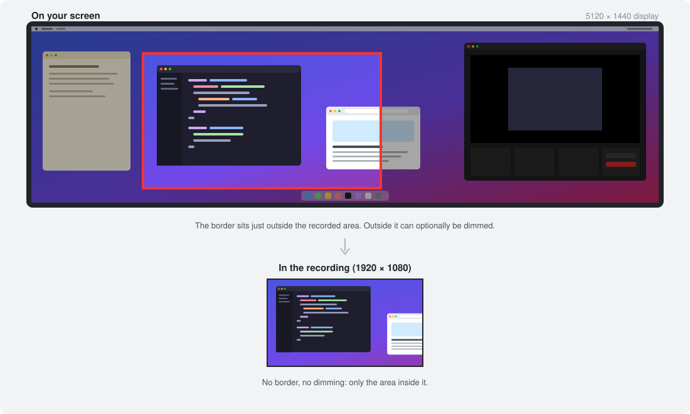
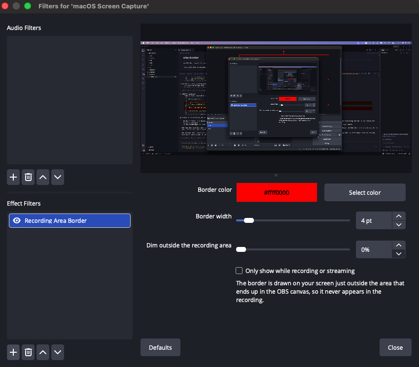

# obs-border

An OBS filter for macOS. It draws a border on your screen around the part of the display that ends up in the OBS canvas. The border itself doesn't show up in the recording.

This is useful when you capture a wide display (say 5120x1440) into a 1920x1080 canvas. You can see where the recorded area is without keeping the OBS preview on screen.

## Screenshots





*The filter's settings in OBS.*

## How it works

- You add the filter to a **macOS Screen Capture** (Display) or legacy **Display Capture** source.
- The filter reads the source's position, scale, rotation and crop in the current program scene. From those it works out which rectangle of the display falls inside the canvas.
- A transparent, click-through overlay window draws the border just *outside* that rectangle, so it can't be captured. The window also sets `NSWindowSharingNone`.
- The border follows along when you move or resize the source, switch scenes, or hide the source.
- The video passes through the filter unchanged.

## Build and install

Requires Xcode command line tools and OBS installed at `/Applications/OBS.app`. The first build downloads the matching libobs headers and SIMDe into `deps/`.

```sh
make install     # builds and copies to ~/Library/Application Support/obs-studio/plugins
```

Then restart OBS. Use `make OBS_APP=/path/to/OBS.app` for a different install location.

## Usage

1. Right-click your display capture source → **Filters**.
2. Under Effect Filters, click **+** → **Recording Area Border**.
3. Options:
   - Border color (with alpha)
   - Border width
   - Dim everything outside the recording area
   - Only show the border while recording or streaming

Turn the filter off with its eye icon to hide the border.

## Limitations

- Only display captures are supported, not window or application capture.
- If another filter on the same source crops or pads it (for example Crop/Pad), the border will be offset. Use the scene item's own crop (Alt-drag or Edit Transform) instead.
- Nested scenes aren't followed. The source must sit directly in the program scene, or in a group inside it.
- If the recorded area touches an edge of the screen, that side of the border has no room and is not drawn.

## License

MIT, see [LICENSE](LICENSE).
